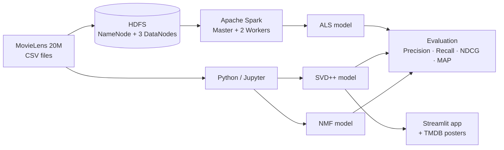

# Big Data-Scale Comparative Film Recommendation System

A comparative movie recommendation system built on the **MovieLens 20M** dataset, benchmarking three collaborative filtering algorithms — **SVD++**, **NMF** and **ALS** — and serving personalised Top-10 recommendations through a **Streamlit** web app.

ALS was trained on a distributed **Apache Spark** cluster reading data from **HDFS**, with the whole infrastructure running on **Docker**.

> MSc Project — Yıldız Technical University, Computer Engineering (2026)

---

## Highlights

- **~20M ratings** from 138,493 users on 27,278 movies (MovieLens 20M)
- **3 algorithms compared** across 12 hyperparameter / filtering configurations: SVD++, NMF, ALS
- **Distributed setup:** HDFS cluster with 3 DataNodes + Spark cluster with 2 Workers on Docker
- **Ranking metrics:** Precision@10, Recall@10, NDCG@10, MAP
- **Streamlit app** for existing users (by user ID) and new users (rate a few movies → get recommendations), with movie posters from the TMDB API

## Results

Best configuration of each algorithm (min. 50 ratings per user, relevance threshold 3.5):

| Algorithm | Precision@10 | Recall@10 | NDCG@10 | MAP |
|-----------|:------------:|:---------:|:-------:|:---:|
| **SVD++** | **0.8090** | **0.5543** | **0.8880** | **0.8169** |
| ALS (Spark) | 0.8042 | 0.5526 | 0.8843 | 0.8115 |
| NMF | 0.7682 | 0.5323 | 0.8370 | 0.7450 |

Retraining the best models on more active users (min. 100 ratings per user) improved ranking quality further:

| Algorithm (min. 100 ratings/user) | Precision@10 | NDCG@10 | MAP |
|-----------|:------------:|:-------:|:---:|
| **SVD++** | **0.8659** | **0.8902** | **0.8257** |
| ALS (Spark) | 0.8608 | 0.8865 | 0.8197 |
| NMF | 0.8102 | 0.8286 | 0.7384 |

SVD++ achieved the best overall performance, while ALS on the distributed Spark cluster came very close.

## Architecture



## Methodology

1. **Preprocessing:** movies with fewer than 50 ratings and users with fewer than 100 ratings were filtered out.
2. **Split:** stratified 80% train / 20% test split per user.
3. **Training & tuning:** multiple hyperparameter combinations were tested for each algorithm.
4. **Evaluation:** Top-10 recommendations evaluated with Precision@10, Recall@10, NDCG@10 and MAP.

## Tech Stack

`Python` · `Apache Spark (PySpark MLlib)` · `HDFS` · `Docker` · `Jupyter` · `Streamlit` · `pandas` · `NumPy` · `TMDB API`

## Project Structure

```
├── notebooks/
│   ├── 01_main_svdpp_nmf_comparison.ipynb   # EDA, SVD++ / NMF training, comparison, ALS results
│   ├── 02_nmf_hyperparameter_tuning.ipynb   # NMF hyperparameter experiments
│   └── 03_nmf_min_user_100.ipynb            # Final NMF model (min. 100 ratings/user)
├── spark/                # PySpark ALS training (als_model.py, als_model_100.py) and precomputed recommendations
├── app/                  # Streamlit recommendation app
├── docker-compose.yml    # HDFS + Spark cluster
├── hadoop.env            # Hadoop configuration
└── requirements.txt
```

## How to Run

**1. Get the data**
Download the [MovieLens 20M dataset](https://grouplens.org/datasets/movielens/20m/) and place `rating.csv` and `movie.csv` in a `data/` folder. (The dataset is not included in this repo due to its size and license.)

**2. Start the HDFS + Spark cluster**
```bash
docker-compose up -d
docker exec namenode hdfs dfs -mkdir -p /user/data
docker exec namenode hdfs dfs -put /data/rating.csv /user/data/
```

**3. Train ALS on Spark**
```bash
docker exec spark-master /spark/bin/spark-submit --master spark://spark-master:7077 /spark/als_model_100.py
```

**4. Train SVD++ / NMF**
Install dependencies and run the notebooks in `notebooks/`:
```bash
pip install -r requirements.txt
```

**5. Run the Streamlit app**
Add your TMDB API key to `.streamlit/secrets.toml`:
```toml
TMDB_API_KEY = "your_key_here"
```
Place the trained models (`svdpp_best_model_100.pkl`, `nmf_best_model_100.pkl`) and the `als_recommendations/` output in the project root, then run from the project root:
```bash
streamlit run app/streamlit_app.py
```

## Author

**Huseyin Yildiz** — Data Engineer
[LinkedIn](https://www.linkedin.com/in/huseyin-yildiz98)
